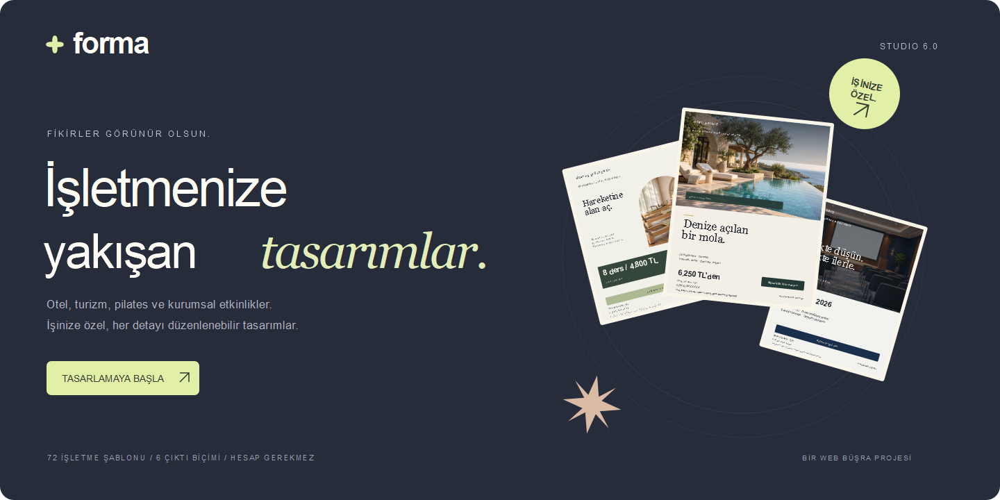
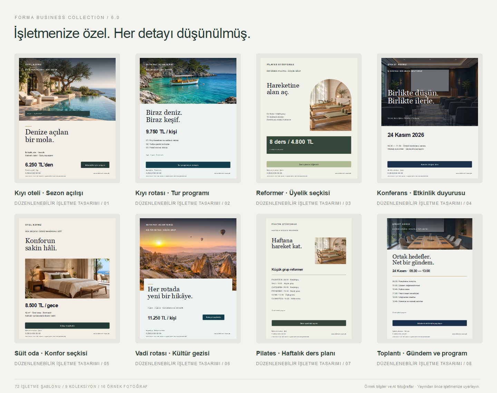

# Forma Business Studio 6.0.1

**İşletmenize yakışan tasarımlar.**

Konaklama, seyahat, pilates, kurumsal etkinlik ve hizmet işletmeleri için **72 düzenlenebilir şablon**. Bağımlılıksız, tarayıcıda çalışan tasarım editörü; fotoğraf, metin, marka ve fiyat alanlarını değiştirerek ilan, teklif, ders programı ve davet hazırlayın.



Vanilla JavaScript · SVG · Canvas · IndexedDB · Harici API veya hesap gerektirmez

## Yalnızca işletme koleksiyonları

| Koleksiyon | Adet | Tasarımlar |
| --- | ---: | --- |
| Otel & konaklama | 8 | Sezon açılışı, süit oda, erken rezervasyon, hafta sonu, uzun konaklama, özel paket, sezon duyurusu, yatay reklam |
| Turizm & seyahat | 8 | Kıyı turu, kültür rotası, özel seyahat, erken kayıt, hafta sonu, tekne turu, dikey duyuru, grup turu |
| Pilates & wellness | 8 | Reformer üyeliği, tanışma dersi, özel ders, haftalık program, aylık paket, kurumsal grup, randevu, yeni dönem |
| Toplantı & etkinlik | 8 | Konferans, toplantı gündemi, kurumsal davet, atölye, yönetim toplantısı, webinar, eğitim programı, yatay davet |
| Emlak | 8 | Satılık/kiralık ilan, açık ev, portföy, danışman ve satıldı duyurusu |
| Kuaför | 8 | Saç tasarımı, balayage, bakım, açılış, randevu ve hizmet menüsü |
| Güzellik | 8 | Bakım ritüeli, paket, ürün/hizmet, açılış ve randevu |
| Otomotiv | 8 | Araç vitrini, detaylı ilan, bakım, detailing ve randevu |
| İşletme kampanyaları | 8 | Hizmet teklifi, sezon fırsatı, açılış, portföy, hediye kartı ve indirim |

Önceki **48 genel, monogram ve soyut şablon** galeriden, aramadan ve önerilerden çıkarıldı. Eski FORMA dosyalarını bozmamak için geçmiş kompozisyonların okuma desteği kaynakta tutulur; bunlar yeni şablon olarak sunulmaz. Boş tuval oluşturma ayrı bir editör işlevidir.



Bu görseller uygulama ekran görüntüsü değil, şablon üreticisinden alınmış düzenlenebilir tasarım örnekleridir. Örnek fiyat, tarih, adres ve işletme adlarını yayınlamadan önce değiştirin. CTA'lar tasarım metnidir; uygulama bir rezervasyon veya etkinlik kayıt sistemi değildir.

## Çalıştır

Node.js **22+**:

```sh
npm start
```

**http://127.0.0.1:4173/** adresini açın. Kurulacak bağımlılık yoktur; `npm install` gerekmez. PowerShell betik kısıtlaması varsa `npm.cmd start` kullanın.

XAMPP için klasörü `htdocs/forma` altına koyup **http://localhost/forma/** adresini açın. Apache 2.4 için güvenlik başlıkları, dizin listeleme ve özel dosya erişim kısıtları `.htaccess` içindedir. Farklı Apache kurulumlarında ilgili modüller ve `AllowOverride` ayarları gerekir. `file://` desteklenmez.

```sh
npm run check            # JavaScript sözdizimi
npm test                 # Model, çıktı, depolama, güvenlik ve HTTP testleri
npm run audit            # Statik kaynak/anahtar taraması ve fotoğraf bütünlüğü
npm run package          # Denetlenen GitHub kaynak ZIP'i
npm run cover            # Geçici SVG kapak kaynağını üret
npm run catalog          # Geçici SVG sektör seçkisini üret
npm run assets:manifest  # Bilinçli görsel değişikliği sonrası hash manifestini yenile
```

PNG doküman önizlemeleri SVG kaynaklarından ImageMagick ile render edilmiştir; ImageMagick çalışma zamanı bağımlılığı değildir. Yeniden üretilen SVG dosyaları `tmp/generated/` içinde tutulur ve GitHub paketine alınmaz.

## Çalışma alanı ve editör

- Şablon önizlemesi, kalıcı favoriler, Türkçe/aksansız arama, sektör ve biçim filtreleri.
- Proje yeniden adlandırma, kopyalama, güncelleme ve kaldırılan kaydı 12 saniye içinde geri alma.
- Yeni tasarıma geçerken önceki taslağın yedeklenmesi; `Ctrl / ⌘ K` hızlı erişim.
- Belge başına 12 sayfa, sayfa başına 40 katman; çoklu seçim, grup, kilit, görünürlük, sıralama.
- Tuvalde taşıma, boyutlandırma, dönüş, hizalama, eşit dağıtma ve sunum modu.
- Altı sistem font ailesi, 24 sembol, şekiller, serbest çizim, üç veri grafiği ve **20 palet**.
- Marka kiti, geçişli zemin, doku ve saydamlık; görsel kırpma, maskeleme, çevirme ve renk ayarları.
- Sektöre göre etiketlenen İşletme paneli; altı satıra kadar düzenlenebilir ders/toplantı programı, web ve iletişim alanları.

`index.html` çalışma alanıdır; `editor.html` taslağı açar. Şablon/proje açılış parametreleri yüklemeden sonra URL'den kaldırılır; yenileme mevcut taslağı başlangıç şablonuyla değiştirmez.

## Görseller ve çıktılar

Pakette **16 yerel AI örnek fotoğraf** bulunur. Yeni sekiz fotoğraf otel, turizm, pilates ve toplantı sektörleri için bu sürümde üretildi. Uygulama içinde canlı AI üretimi yoktur. Seçili fotoğraflar doğrulanıp projeye gömülür; dışa aktarım uzak fotoğraf servisine bağlı değildir.

**SVG, PNG, JPG, WebP, raster PDF ve düzenlenebilir FORMA JSON**. Çok sayfalı görseller tek ZIP içinde indirilir. Kare, 4:5, hikâye ve sunum başlangıç çıktıları 1080×1080, 1080×1350, 1080×1920 ve 1920×1080'dir. Uzun kenar 512–4096 px seçenekleriyle belirlenir. Özel tuvalin 128–2048 birim iç ölçüsü ile çıktı çözünürlüğü ayrıdır.

SVG fontları gömülmez; sistem fontları kullanılır. JPG saydamlığı beyazla birleştirir. PDF sayfaları 2048 px uzun kenarda rasterleştirilir; vektör metin, CMYK veya baskı taşması sunulmaz.

## Güvenlik ve yerel veri

Taslaklar, projeler ve favoriler IndexedDB'de bu tarayıcıda tutulur; localStorage zaman damgalı arıza yedeğidir. Bu alanlar şifreli kasa değildir. Bulut eşitleme, hesap, sunucuya görsel yükleme veya ödeme bulunmaz. Tarayıcı verilerini temizlemek yerel kayıtları siler. Önemli çalışmalarınızı FORMA dosyası olarak indirin.

İçe aktarılan veri izin verilen alanlardan yeniden kurulur. SVG yüklenmez; PNG/JPG/WebP imza ve boyutları doğrulanır. Dosya başına 8 MB / 20 megapiksel, belge başına 24 görsel ve 20 MB proje sınırı uygulanır. Görsel bütçesi yaklaşık 9 MB ikili veridir. Görselli belgeler dosyayla paylaşılır; metin/vektör bağlantıları şifrelenmez.

Yerel Node sunucusu GET/HEAD ve izin verilen dosyalarla sınırlıdır; yabancı Host/Origin isteklerini reddeder. CSP, kaynak kısıtları ve izin başlıkları eklenmiştir. GitHub Actions adımları tam commit SHA'sına sabitlenmiştir. Paketleyici izinli dosya türleri kullanır; sembolik bağlantı, gizli anahtar, ortam dosyası, kişisel proje ve eski ekran görüntülerini pakete almaz.

**44 otomatik test**; aktif koleksiyonlar, eski dosya geçişi, Unicode, enjeksiyon, model/veri sınırları, görsel başlıkları, PDF/ZIP, depolama kurtarma, arama ve HTTP erişim kurallarını kapsar. Statik taramanın kapsamı [AUDIT-REPORT.json](docs/AUDIT-REPORT.json), elle kontrol senaryoları [QA.md](docs/QA.md) içindedir. Bunlar sızma testi veya tüm tarayıcı etkileşimlerinin doğrulandığı anlamına gelmez.

## Lisans ve telif

Mevcut [MIT lisansı](LICENSE.txt) ve Büşra Seçkin telif bildirimi korunur. Lisans kapsamı, AI fotoğraflar, sistem fontları, örnek markalar ve inceleme sınırları [THIRD_PARTY_NOTICES.md](THIRD_PARTY_NOTICES.md) içinde açıklanır. Fotoğraf üretim bilgileri [ASSETS.md](docs/ASSETS.md), yeni son istemler [IMAGEGEN-PROMPTS.json](docs/IMAGEGEN-PROMPTS.json), dosya hash'leri [ASSET-MANIFEST.json](docs/ASSET-MANIFEST.json) içindedir.

Üçüncü taraf çalışma zamanı paketi veya font dosyası dağıtılmaz. AI görseller için benzersizlik, üçüncü kişi haklarından tamamen arınmış olma veya her ticari kullanıma hukuki uygunluk garantisi verilmez. Kendi yüklediğiniz logo/fotoğrafların hakları bu deponun lisansıyla değişmez.

## GitHub paketi

`npm run package` kökte **`forma-design-studio-github.zip`** oluşturur. Arşivin **içeriğini depo köküne** yükleyin; `index.html`, `editor.html`, `src/` ve `assets/` aynı seviyede bulunmalıdır. Uygulamanın tamamı göreli yollar kullanır; GitHub Pages depo alt diziniyle uyumludur.

[Temizlik ve güvenlik incelemesi](docs/RELEASE-REVIEW.md) · [GitHub yükleme rehberi](docs/GITHUB-YUKLEME.md) · [Mimari](docs/ARCHITECTURE.md) · [Katkı](CONTRIBUTING.md) · [Güvenlik](SECURITY.md) · [Sürüm notları](CHANGELOG.md)

**Büşra Seçkin**'in portfolyosu için AI desteğiyle geliştirilmiş bağımsız bir projedir. Gerçek müşteri işi veya doğrulanmış işletme teklifleri olarak sunulmaz. Bu kaynak paketi otomatik olarak GitHub'a yükleme veya yayın yapmaz.
